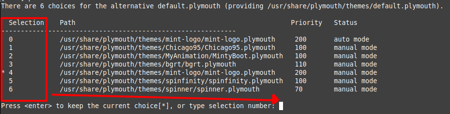

###############################
Splash Screen
###############################

When you boot up your system and get past the UEFI/BIOS "Manufacturer" Screen, You should be greeted by a spinning logo of Linux Mint. 

This is Plymouth. Its job is to make the process of booting look nice when compared to walls of text that comprise of the boot logs.

By pressing `Esc`, You are able to see the text output of the boot processes.

How it works
=============

Its one of the first things that Systemd starts after the kernel loads. It reads from `/usr/share/plymouth/themes/default.plymouth` and loads in the respective image files in order to show the splash screen. 

Changing the Boot Screen
=========================

Firstly, You first open the `Files` app, and go to "`/usr/share/plymouth/themes`".

**If you have a custom theme you want to add**, Right click and select "Open as Root".

Then, Drag in your chosen folder with your boot screen image files and accompanying `.plymouth` file

.. note::

    If it is an animated boot screen, Make sure that is properly set up in the .plymouth file, More information about animation can be found `here <https://wiki.gentoo.org/wiki/User:DerpDays/Plymouth/Theming>`_.

**Once you're done that or if you want to choose a theme that's already there**, You want to make sure that Plymouth knows that your boot screen is an option with the following command inside of the `Terminal` application:

.. code-block:: bash

    sudo update-alternatives --install /usr/share/plymouth/themes/default.plymouth default.plymouth \ /usr/share/plymouth/themes/(NAME HERE)/(NAME HERE).plymouth 100

Second to last, Run "`sudo update-alternatives \-\-config default.plymouth`" and a list of multiple selections will appear, input the number corresponding to the theme you created.

Lastly, run "`sudo update-initramfs -u`" in order to rebuild and load the new settings onto memory.

Whenever you reboot, It will enact your changes.
